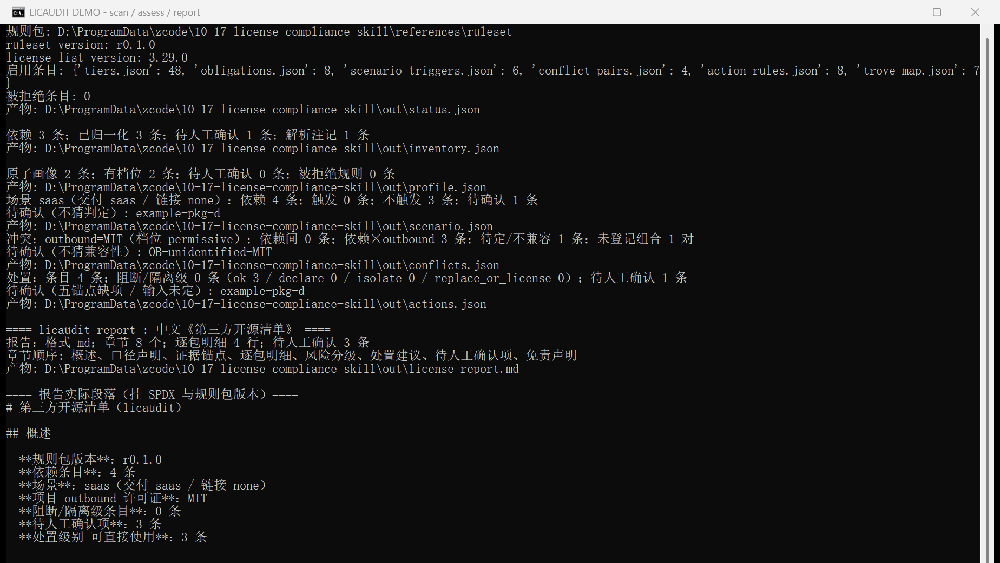

# licaudit — 输入依赖清单，判定开源许可证会不会传染

[](https://github.com/yuluo554/10-17-license-compliance-skill/actions/workflows/ci.yml)




**给要发布或商用开源项目的团队**：拿一份依赖清单（`requirements.txt` / `package.json`），
回答「我这个用法会不会被传染、要不要开源、能不能卖」，输出中文《第三方开源清单》。

## 给谁用

- 准备开源或对外分发产品的团队：发布前自查依赖许可证，决定是否补声明、隔离或换包。
- 做 SaaS / 容器镜像交付的工程团队：需要区分「分发」与「网络交互」两个触发点（AGPL §13）。
- 需要把第三方开源清单写进交付文档、又不想要法律意见式措辞的人。

## 30 秒跑起来

```bash
pip install -e ".[dev]"                 # 要求 Python ≥ 3.8，运行时零第三方依赖
licaudit scan data/synthetic/npm-basic/package.json --out-dir out
licaudit assess --inventory out/inventory.json --scenario saas \
  --network-interaction yes --outbound-license MIT --out-dir out
licaudit report --out-dir out --format md   # → out/license-report.md
```

预期产物 out/license-report.md（中文清单，8 章节）：`assess` 退出码 `1` 表示检出阻断/待确认项，
是**既定语义不是故障**（退出码表见下）。

## 它解决什么问题

取证层（syft / scancode / ORT / license-checker）已经能告诉你「这个包是什么许可证」。
真正卡住人的是判定层：**我这个用法会不会被传染、要不要开源、能不能卖。**
本工具只做判定层：依赖清单 → SPDX 归一化（四级可信度链，禁止全文关键词匹配）
→ 传染强度五档 + 义务项 → 八场景 × 链接方式 × 网络交互 → 冲突 → 四级处置，
每条判定挂五个证据锚点（包名 / 版本 / 声明位置 / SPDX ID / 依据条款）。

**商用本身不是 GPL / AGPL 的触发要件。** 触发点是分发（GPL 系）与网络交互（AGPL §13）。

## 判定依据

| 依据 | 版本 | 生效日期 | 最后复核 |
| --- | --- | --- | --- |
| SPDX License List 快照（`references/spdx/`） | 3.29.0 | 2026-10-17（快照入库日） | 2026-10-17 |
| 规则包 `ruleset_version`（`references/ruleset/`） | r0.1.0 | 2026-10-17 | 2026-10-17 |
| 门禁：契约块三方断言 + AST 零判定守门 + 七个生成器 `--check` 位级一致 | v0.1.0 | 2026-10-17 | 2026-10-17 |

规则包与快照都是**随仓库冻结**的生成物（`--check` 逐字节比对），不是运行时联网取的。
刷新是人工步骤：`py -3.12 tools/fetch_spdx.py --out references/spdx` → `py -3.12 tools/gen_ruleset.py`。

## 退出码

| 码 | 含义 |
| --- | --- |
| `0` | 分析完成且无阻断项 |
| `1` | 检出阻断/隔离级项或待确认项（**既定语义，不是故障**）；或自检/基准未通过 |
| `2` | 用法错误、输入不可用、未知许可证 ID |
| `3` | 规则包缺失或校验失败（不会产出空报告） |

## 已知限制

- **不做**源码许可头扫描、不生成 SBOM、不做 CVE 评分。只回答「传染性与处置」。
- 只覆盖清单里出现的 SPDX ID；未覆盖 ID 输出 `tier: null` + 待人工确认（不猜判定）。
- 冲突对表是**抽样的 4 条**（GPL-2.0 × Apache-2.0 / AGPL-3.0 / GPL-3.0，GPL-3.0 × Apache-2.0）；
  未登记的许可证组合只计入 `conflicts.json.uncovered_pairs`，不判不猜。
- 依赖 × outbound 是**档位级粗判**（`MPL-2.0` 依赖 + `MIT` outbound 输出 `incompatible`），
  暂不看场景是否真的分发；**传染范围聚合（按链接/分发边界）仍未实现**，处置分级改用决策表的
  `link_mode` 维度表达边界是否可分离，登记在 `conflicts.json.notes` / `actions.json.notes`。
- 处置决策表只有 8 条规则（义务轴 + 冲突结论 + 链接方式 → 四级处置），是抽样口径；
  单场景下四级处置无法同时出现，示例报告因此给两份运行。
- **不支持 wheel 安装后直接使用**：规则包在仓库 `references/`，wheel 不含它；sdist 走 `MANIFEST.in`
  白名单自带规则包与快照，解包即自足。需要 wheel 时用 `--rules-dir` 显式指定。
- 输出是自动化清单，不是法律意见：

> 本清单由自动化工具生成，不构成法律意见（非法律意见）。涉及商业分发、诉讼或高价值交易时，请咨询执业律师。

---

> 架构分层、CI 矩阵、规则包生成流程与发布对账见 [DEVELOPMENT.md](DEVELOPMENT.md)。
> 本工具同时是一个 Agent Skill：agent 直接读仓库时的入口与契约块见 [SKILL.md](SKILL.md)；
> 示例报告见 [examples/report/license-report.md](examples/report/license-report.md)。

## 许可

本项目代码以 MIT 发布（见 [LICENSE](LICENSE)）。`references/spdx/` 下的 SPDX 数据来自
<https://spdx.org/licenses/>，遵循 CC0-1.0。